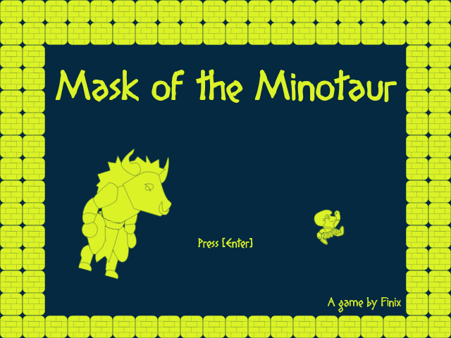
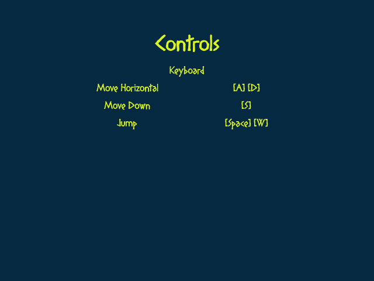
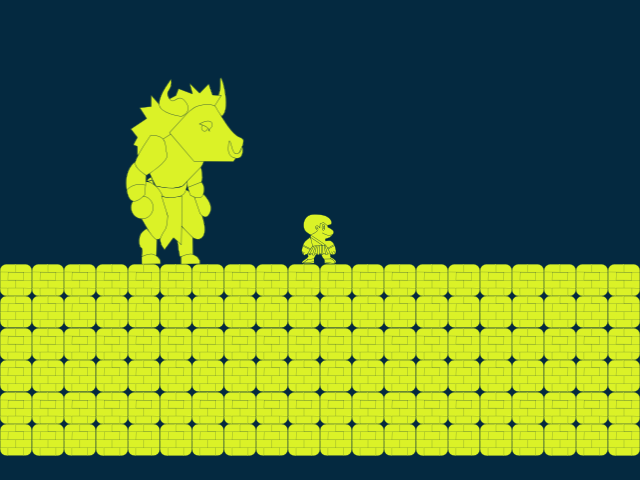
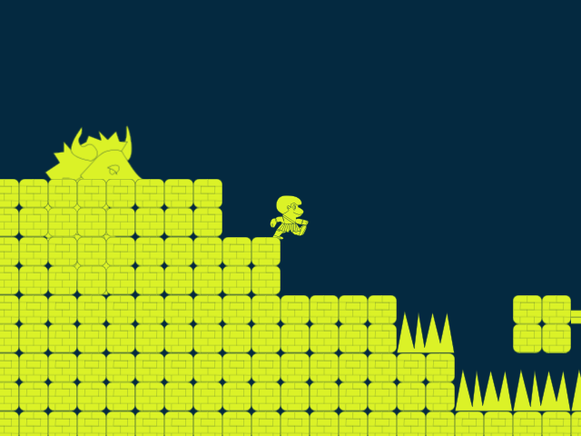
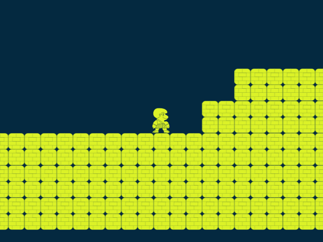
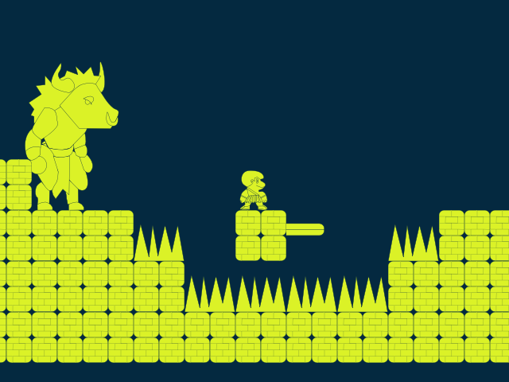
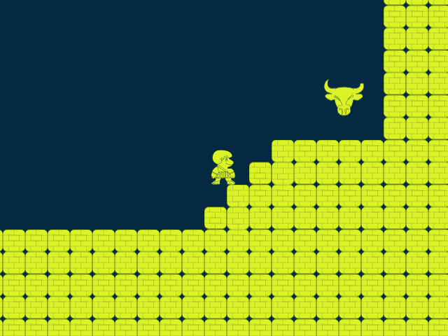
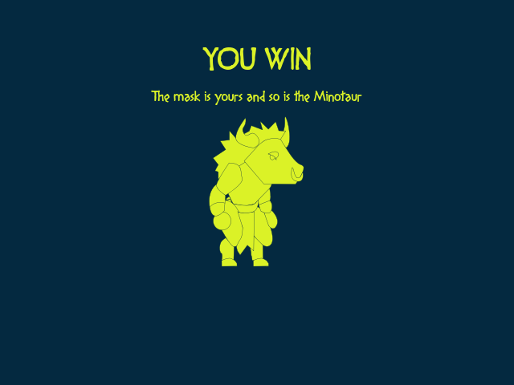

# Mask of the Minotaur

> A fast, punishing 2D platformer made for Global Game Jam 2026. Run through a randomly generated labyrinth of spikes, pits and charging Minotaurs to claim the legendary Taurus mask.



## Table of contents

- [Overview](#overview)
- [Screenshots](#screenshots)
- [How to play](#how-to-play)
- [Controls](#controls)
- [Hazards](#hazards)
- [Level generation](#level-generation)
- [Requirements](#requirements)
- [Getting started](#getting-started)
- [Project structure](#project-structure)
- [How it works](#how-it-works)
- [Known issues](#known-issues)
- [Credits](#credits)
- [License](#license)

## Overview

*Mask of the Minotaur* is a short, tough side-scrolling platformer built in **Godot 4.5** with the GL Compatibility renderer. You play a small hero running to the right across a long, ever-changing course. Falling into a pit, touching spikes, or getting caught by a Minotaur sends you back to the start, and because the course is regenerated each time, no two attempts are the same. Reach the mask at the very end to win.

The game uses a striking two-colour palette (deep navy and acid yellow-green), a bold display font and chunky tile-based terrain. It runs at a 640x480 base resolution scaled with the `canvas_items` stretch mode.

## Screenshots

These were captured by running the project in Godot 4.5.

| Title screen | Controls screen |
| :---: | :---: |
|  |  |
| **Start of the level** | **Running and jumping** |
|  |  |
| **Minotaur patrolling a platform** | **Spikes ahead** |
|  |  |
| **The final zone and the mask** | **Victory screen** |
|  |  |

## How to play

1. On the title screen, press any key.
2. A short **Controls** screen is shown for two seconds, then the level starts automatically.
3. Run right and jump over spikes, pits and gaps. Avoid the Minotaurs patrolling the platforms.
4. If you die (spikes, a Minotaur, or falling out of the world), a brief death animation plays and the level **restarts with a freshly generated course**.
5. Reach the **Taurus mask** in the final zone to win. After the "YOU WIN" screen the game returns to the title screen.

## Controls

| Action | Keys |
| --- | --- |
| Move left / right | `A` / `D` or the left / right arrow keys |
| Jump | `Space`, `W` or the up arrow |
| Drop through thin platforms | Hold `S` or the down arrow, then press jump |

Jump height is variable: release the jump key early to cut the jump short. Dropping through platforms works only on platforms placed on the dedicated "Pass Through" physics layer.

## Hazards

- **Spikes**: instant death on contact.
- **Minotaurs**: patrol a platform at 350 px/s and turn around when they hit a wall. Touching one kills you. You cannot defeat them, only avoid them.
- **Pits**: falling below the bottom of the level (y >= 250) counts as a death.

## Level generation

`level.gd` assembles each run from a small set of hand-made zones, each exactly 640 pixels wide (one screen):

1. An **initial zone** at the start.
2. **24 randomly picked zones** from a pool of five (four obstacle layouts and a rest area), laid out side by side. The first generated zone is always the first one in the pool, and the code tries to avoid the same zone appearing twice in a row.
3. A **final zone** containing the Taurus mask.

That makes a course 26 zones (about 16,640 px) long. The number of zones and the zone length are exported variables on the `Level` node, so you can shorten or lengthen the game from the Inspector.

## Requirements

- [Godot **4.5**](https://godotengine.org/download)
- Any GPU with OpenGL support (the project uses the GL Compatibility renderer)

## Getting started

```bash
git clone https://github.com/FinixGameDev/GGJ-2026.git
cd GGJ-2026
```

1. Open Godot 4.5 and import `project.godot`.
2. Press **F5** to run. The project starts on `main_menu.tscn`.

Or, from the command line:

```bash
godot --path .
```

A `build/` folder is listed in `.gitignore`, and no export presets are committed, so create your own presets in **Project > Export** to build a standalone version.

## Project structure

```
.
├── main_menu.tscn / .gd         Title screen, any key continues
├── controls_menu.tscn / .gd     Controls screen, auto-starts the level after 2 s
├── level.tscn / level.gd        Level root: builds the random course
├── initial_zone.tscn            Starting zone
├── obstacle_1..4.tscn           Obstacle zones
├── rest.tscn                    Rest zone
├── final_zone.tscn              Final zone with the mask
├── taurus_mask.tscn / .gd       Win trigger
├── you_win.tscn / .gd           Victory screen (returns to the title after 2 s)
├── minotaur.tscn                Patrolling enemy
├── spikes.tscn                  Spike hazard
├── tile_set.tres                Tile set used by all zones
├── spritesheet.svg              Hero, Minotaur, mask and tile art
├── DIOGENES.ttf                 Display font
├── jump.wav, death.wav, annoying_song.wav   Sound effects and title music
└── 2d-kit/                      Reusable 2D platformer building blocks
    ├── basic_moving_character_2d   Gravity, horizontal speed, jump
    ├── pass_through_character_2d   Drop-through platform support
    ├── pass_through_player_2d      The player: input, sprites, death
    ├── bumping_enemy_2d            Enemy that reverses at walls
    └── hit_area_2d / hurt_area_2d  Team-based damage areas
```

## How it works

**Character base.** `BasicMovingCharacter2D` provides gravity (2000), horizontal speed (500 px/s default), jump strength (800) and `jump()` / `cancel_jump()`. The player (`PassThroughPlayer2D`) and the Minotaur (`BumpingEnemy2D`) both extend it.

**Player.** `PassThroughPlayer2D` reads the `move_left`, `move_right`, `move_down` and `jump` input actions, switches between idle, move, jump and dead sprites, flips the sprite when it changes direction, and plays jump and death sounds. Holding down while pressing jump disables collision with the pass-through layer so the player can drop through a platform.

**Damage.** Hazards use `HitArea2D` (with a damage value and team) and the player has a `HurtArea2D`. When a hit lands on an opposing team, the hurt area emits `hurt`, which calls `_on_hurt` on the player: the dead sprite is shown, controls are disabled, and the scene is reloaded after one second.

**Winning.** `taurus_mask.gd` changes to `you_win.tscn` when a `PassThroughPlayer2D` enters its area. The win screen waits two seconds, then returns to the main menu.

## Known issues

- **Every death rerolls the course.** There are no checkpoints, and `reload_current_scene()` runs `_ready()` again, so a new random layout is generated every attempt.
- **"No repeat" logic is imperfect.** The code that tries to avoid identical neighbouring zones can still pick the same zone twice in a row.
- **Hard-coded kill height.** The pit death check uses `position.y >= 250`, so changing the level's vertical layout means changing that number as well.
- **Any key advances the title screen**, including key releases, and the controls screen cannot be skipped.
- **Leftover kit code.** `2d-kit/player_character_2d.gd` (a simpler player without pass-through) is not used by the game, and the team names in `HitArea2D` ("Taurus", "Player") and `HurtArea2D` ("Not Player", "Player") are not the same list.
- **No gamepad bindings and no pause or settings menu.**

## Credits

A game by **Finix** for Global Game Jam 2026.

## License

Released under the [MIT License](LICENSE).
